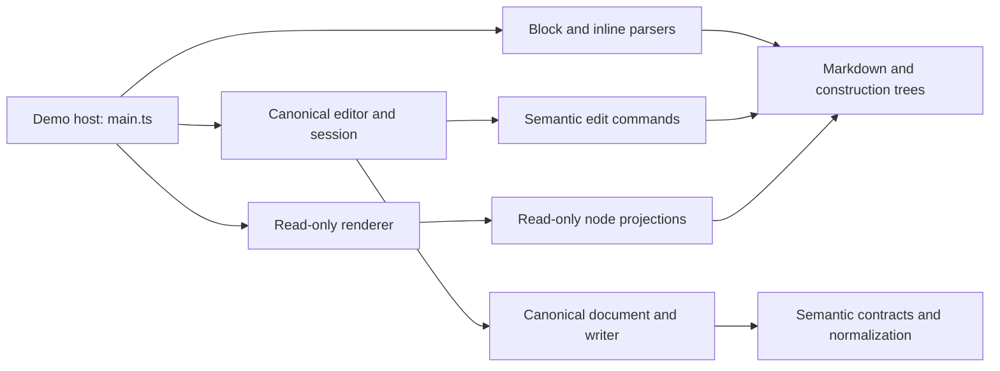

# Grain module map

Grain parses Markdown into a structured tree, edits that tree through explicit commands, and projects it into the browser. The demo host connects those layers. The source tree also keeps six documented direct-import facades for the parser, inline parser, canonical model and actions, serializer, and Markdown node types.

## Layers

The tree is the source of document structure. Parsing builds a `ConstructionTree`; editing commands receive a draft over the live canonical document; renderers read node projections. The canonical implementation owns Yjs state. Parser and command code use semantic contracts and do not import that implementation. The demo host owns Source input and application wiring.

| Layer                     | Main paths                                                                                             | Owns                                                                                                           |
| ------------------------- | ------------------------------------------------------------------------------------------------------ | -------------------------------------------------------------------------------------------------------------- |
| Semantic model            | `src/markdown/semantic/`                                                                               | Node kinds, tree draft contracts, construction storage, normalization, queries, and selection data.            |
| Parsing and serialization | `src/markdown/block-parser/`, `src/markdown/inline-parser/`, `src/markdown/block-serializer.ts`        | Chunked block parsing, inline parsing, provenance, snapshots, and structural Markdown output.                  |
| Canonical storage         | `src/markdown/canonical/`, `src/markdown/canonical-text.ts`                                            | Schema 2 state, accepted updates, action planning, native text history, and stable canonical projections.      |
| Editing                   | `src/editing/commands/`, `src/editing/operations/`, `src/editing/canonical-editor.ts`                  | Scoped document commands, input translation, session attribution, selection, focus, and undo/redo integration. |
| Rendering                 | `src/markdown/*render.ts`, `block-ui.ts`, `transclusion.ts`, `node-view.ts`, `construction-preview.ts` | Read-only DOM projections, rendering extensions, and user intent events.                                       |
| Host                      | `src/main.ts`                                                                                          | Source editing, parsing and preview wiring, document setup, and custom-element registration.                   |

`CanonicalDocument.fromMarkdown()` is the document convenience entry that calls the block parser. The parser itself has no Yjs or browser dependency. Keep that adapter at the document boundary; parser and semantic implementation modules remain reusable without the host.

## Direct source facades

These are repository source imports. `package.json` is private and does not declare a published npm export map.

| Import path                           | Use                                                                                            |
| ------------------------------------- | ---------------------------------------------------------------------------------------------- |
| `src/markdown/block-parser/api.ts`    | Create a streaming parser, parse complete Markdown, and inspect parser conversions.            |
| `src/markdown/inline-parser/index.ts` | Parse inline Markdown into an inline tree.                                                     |
| `src/markdown/canonical-model.ts`     | Create or restore canonical documents and access stable canonical nodes.                       |
| `src/markdown/canonical-actions.ts`   | Prepare and apply canonical actions through `CanonicalWriter` and its documented action types. |
| `src/markdown/block-serializer.ts`    | Serialize Markdown node trees.                                                                 |
| `src/markdown/node.ts`                | Use parser-facing Markdown node types and `isInlineNode`.                                      |

`src/markdown/canonical-facades.test.ts` imports these paths directly. `src/main.browser.test.ts` separately checks registration of the ten application custom elements through `src/main.ts`.

## Change ownership

- A parser change belongs in `block-parser` or `inline-parser`; keep chunk schedules, incomplete prefixes, snapshot/resume, and structural serialization covered.
- A document invariant belongs in `semantic` or the canonical validation and normalization path. Do not make each command repair a global invariant.
- A user edit belongs in a semantic command. The editor session owns its acceptance, history, focus, and selection effects.
- A presentation change belongs in the renderer or host. Renderers can emit typed intent; the host routes it through the active editor session.
- A host feature belongs in `main.ts` or another host adapter. Do not add persistence, navigation, search, or application policy to the Markdown core.

See [Edit authoring](./edit-authoring.md) for the command contract and [Legacy retirement](./legacy-retirement.md) for the reviewed removals and remaining release gates.
